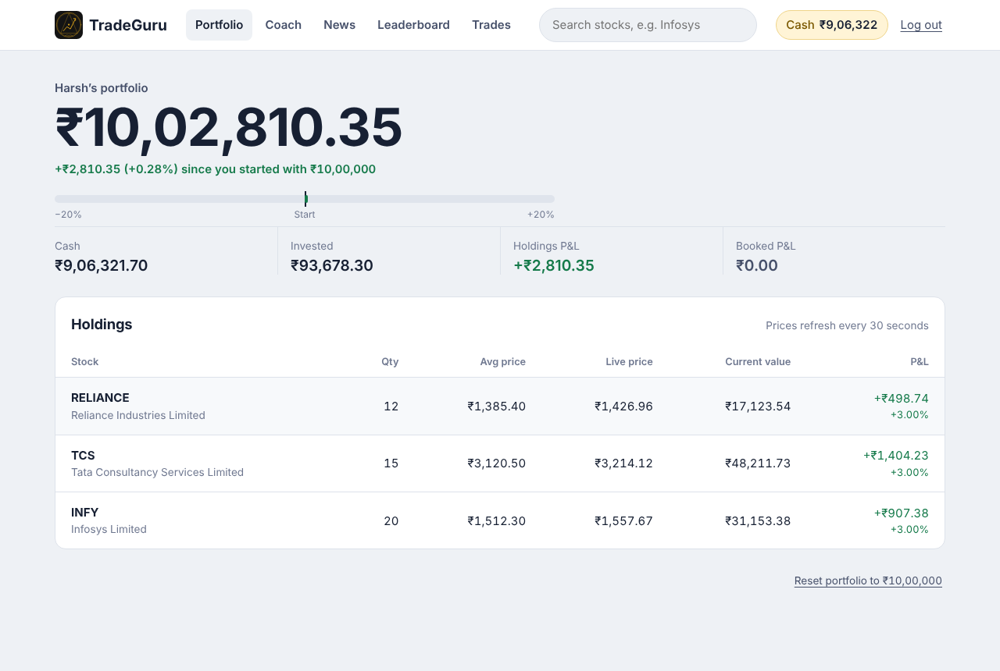
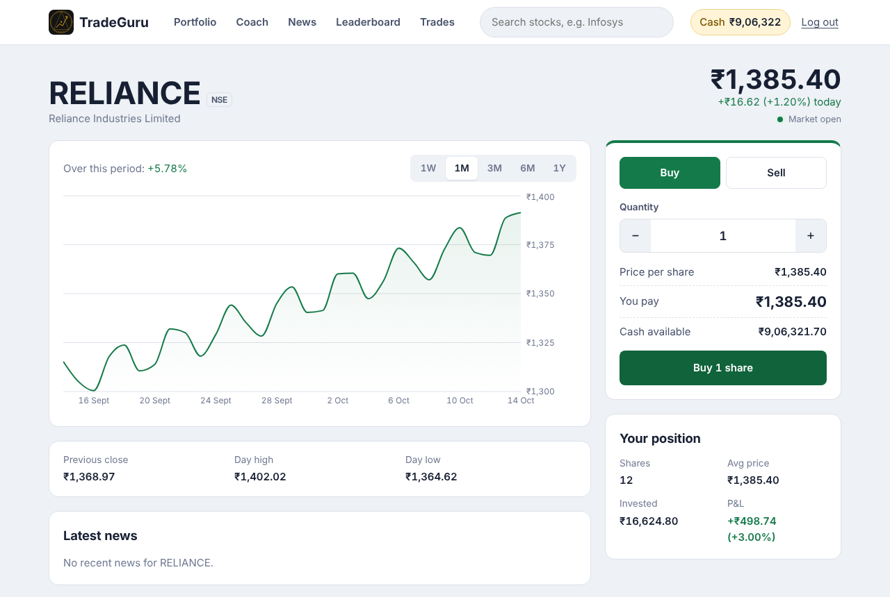
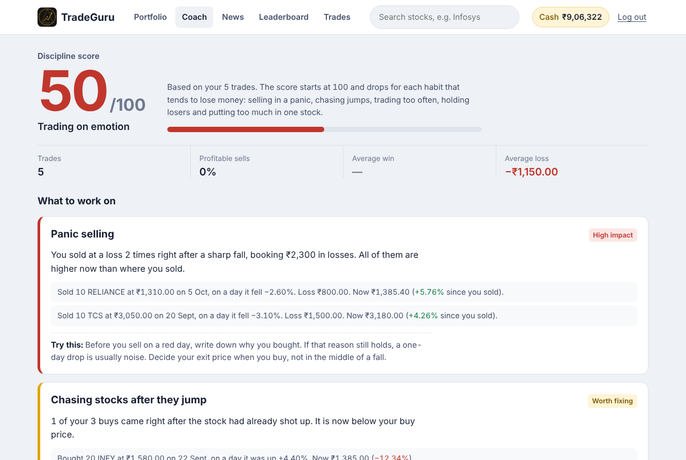
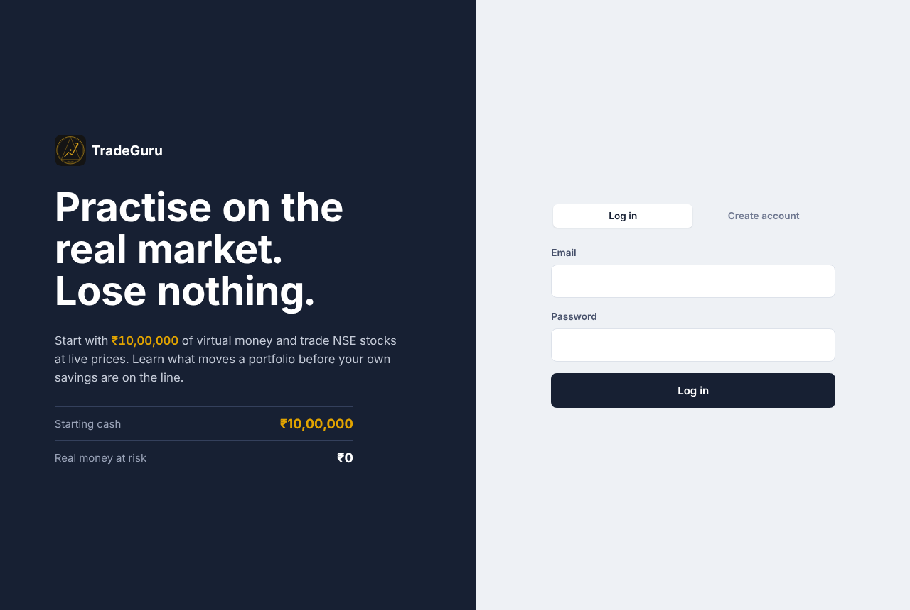
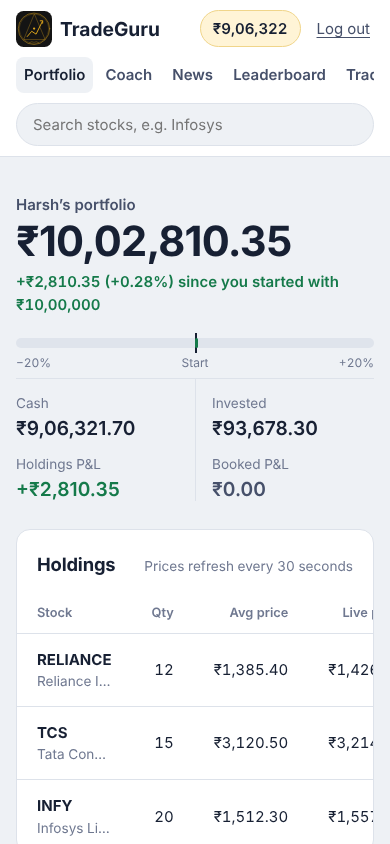
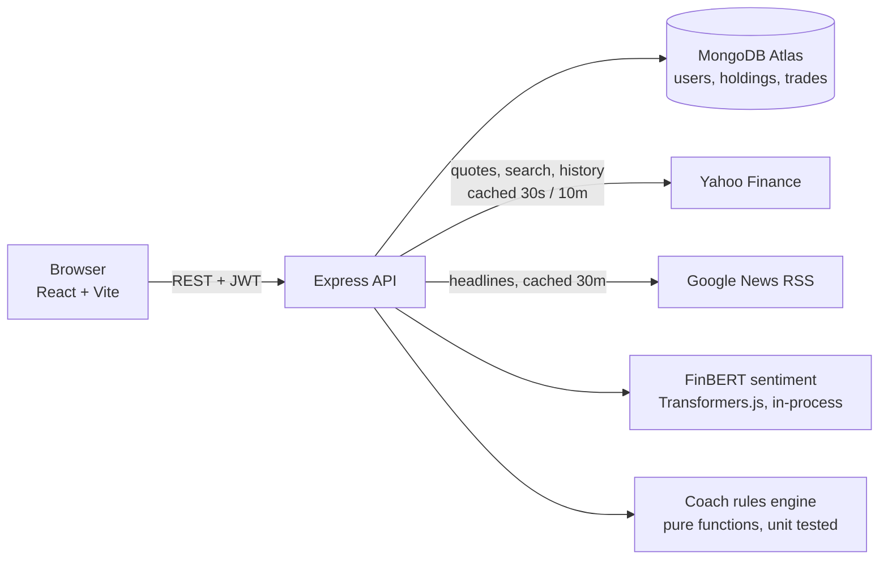

<p align="center">
  
</p>

<h1 align="center">TradeGuru</h1>
<p align="center"><b>Practise on the real Indian stock market with ₹10,00,000 of virtual money, and get coached on your trading habits.</b></p>

<p align="center">
  <a href="#">Live demo</a> ·
  <a href="#features">Features</a> ·
  <a href="#architecture">Architecture</a> ·
  <a href="#run-it-locally">Run locally</a>
</p>



## Why

Most first-time investors learn by losing real money: panic selling on a red day, buying a stock right after it has already jumped, or trading twenty times a day. TradeGuru lets you make those mistakes with virtual money on **live NSE/BSE prices**, then shows you exactly which habits cost you and what to do instead.

## Features

- **Paper trading on real prices.** Search any NSE/BSE listed company, see live price and 1W–1Y charts, buy and sell with ₹10 lakh of virtual cash.
- **Portfolio with live P&L.** Average buy price, unrealised and booked P&L, net worth vs the ₹10 lakh start, refreshed every 30 seconds.
- **Trading Coach.** A behavioural analytics engine reviews every trade and scores discipline out of 100. It detects six habits, each backed by the user's own trades as evidence:
  - panic selling after a sharp fall
  - chasing stocks after a big run-up (FOMO)
  - overtrading
  - holding on to large losers
  - booking small profits too early
  - putting too much money in one stock
- **News with AI sentiment.** Daily finance, fintech, technology and economy headlines. Each headline is classified positive / neutral / negative by **FinBERT**, a BERT model fine-tuned on financial text, running locally in Node.js through Transformers.js (no paid API). Stock pages show company-specific news with a mood summary.
- **Leaderboard.** Traders ranked by total value, with names shortened for privacy.
- **Production-minded backend.** JWT auth, bcrypt hashing, atomic balance updates (no negative cash under concurrent orders), price/chart/news caching, user-safe error messages, unit tests.

| Stock page | Trading Coach |
|---|---|
|  |  |

| Login | Mobile |
|---|---|
|  |  |

## Tech stack

| Layer | Tech |
|---|---|
| Frontend | React 19, Vite, React Router, Axios, Recharts, plain CSS |
| Backend | Node.js, Express 5, Mongoose |
| Database | MongoDB Atlas |
| Auth | JWT, bcrypt |
| Market data | `yahoo-finance2` (NSE/BSE quotes, search, daily history) |
| News | Google News RSS via `rss-parser` |
| AI | FinBERT (`Xenova/finbert`) via `@huggingface/transformers` (ONNX, runs on the server) |
| Testing | Node.js built-in test runner |
| Deploy | Render (API), Vercel (frontend) |

## Architecture



**How a trade works:** the API fetches the live price, then deducts cash with a single conditional update (`balance >= cost`) so two simultaneous orders can never overspend. The holding's quantity and invested amount are updated, and the trade is stored with the day's price move so the coach can analyse it later.

**How the coach works:** `server/services/coachRules.js` is a pure function over trades, holdings, current prices and 3-month price history. Thresholds live in one `RULES` object. Every finding returns the trades that triggered it, so advice is specific ("You sold 10 TCS at ₹3,050 on a day it fell 3.1%; it's ₹3,180 now"), not generic.

## Run it locally

You need Node.js 18+ and a free MongoDB Atlas cluster.

```bash
# 1. Backend
cd server
cp .env.example .env     # add MONGO_URI and JWT_SECRET
npm install
npm run dev              # http://localhost:5000

# 2. Frontend (new terminal)
cd client
npm install
npm run dev              # http://localhost:5173
```

The first news request downloads the FinBERT model (~110 MB) once. Set `SENTIMENT=off` in `server/.env` to skip it.

## Tests

```bash
cd server
npm test
```

Covers P&L maths (average price, realised/unrealised P&L, rounding), every coach rule, and news feed parsing.

## API

| Method | Route | Description |
|---|---|---|
| POST | `/api/auth/signup`, `/api/auth/login` | Create account / log in |
| GET | `/api/stocks/search?q=` | Search NSE/BSE stocks |
| GET | `/api/stocks/:symbol/quote`, `/chart?range=1m` | Live quote, price history |
| POST | `/api/trade/buy`, `/api/trade/sell` | Place an order |
| GET | `/api/trade/history` | Trade history |
| GET | `/api/portfolio` | Holdings, live P&L, summary |
| GET | `/api/coach` | Discipline score and findings |
| GET | `/api/leaderboard` | Top traders |
| GET | `/api/news?category=`, `/api/news/stock/:symbol` | Headlines with sentiment |

## Limitations

- Market data comes from Yahoo Finance's free feed and can be delayed by up to ~15 minutes. A production broker app would use a licensed exchange feed.
- Brokerage, taxes, dividends and corporate actions (splits, bonuses) are not modelled.
- Sentiment is model output and can misread context (for example "inflation rises" may be tagged positive).
- Orders fill instantly at the last price; there is no order book or slippage.

## Project structure

```
tradeguru/
├── server/          Express API (routes, models, services, tests)
├── client/          React app (pages, components)
├── docs/            screenshots
└── render.yaml      Render deploy blueprint
```
